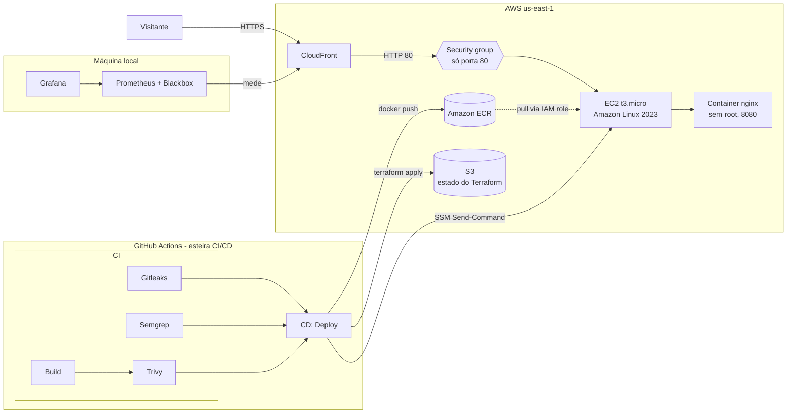

# Inclui+

CitizenTech de acessibilidade: nota separada por necessidade (mobilidade, visão, audição e cognição), fotos como evidência e um assistente em linguagem natural.

Projeto da Global Solution FIAP 2026.2. **Os locais, as notas e os descontos são fictícios.**

## Ficha Técnica do MVP

| Item | Valor |
|---|---|
| Projeto | Inclui+ |
| Turma | 4ESPW |
| Integrantes | Nome Completo (RM00000) · Nome Completo (RM00000) · Nome Completo (RM00000) |
| URL pública | `https://SEU-ID.cloudfront.net` (aparece no resumo de cada execução da esteira CI/CD) |
| Repositório | https://github.com/kaikyalvaro1708/inclui-gs |
| Aplicação | Site estático: HTML, CSS e JavaScript puro, sem framework e sem build |
| Container | `nginxinc/nginx-unprivileged:1.30-alpine`, usuário `nginx` (sem root), porta 8080 |
| Registry | Amazon ECR, repositório `inclui-gs`, tags imutáveis com o SHA do commit |
| Nuvem | AWS, região `us-east-1` |
| Infraestrutura | Terraform: VPC, sub-rede pública, internet gateway, security group, IAM role, ECR, EC2 `t3.micro` e CloudFront |
| Estado do Terraform | Bucket S3 privado, versionado e criptografado (fora do repositório) |
| Esteira CI/CD | GitHub Actions: CI com build, Gitleaks, Semgrep e Trivy a cada push; CD com deploy automático na `main` |
| Observabilidade | Prometheus, Blackbox Exporter, nginx exporter e Grafana via `docker compose` |
| Custo estimado | Cerca de US$ 12 por mês com a infraestrutura ligada ([detalhes](#estimativa-de-custo)) |

## Arquitetura



- **Rede**: VPC `10.0.0.0/24` com uma sub-rede pública, internet gateway e tabela de rotas.
- **Porta administrativa**: não existe. O security group libera só a porta 80; não há SSH (porta 22). A administração da EC2 é feita pelo AWS Systems Manager (SSM), que não precisa de porta aberta.
- **EC2**: IMDSv2 obrigatório e disco criptografado. A instância puxa a imagem do ECR com a própria IAM role, sem credencial gravada em disco.
- **Container**: roda com `--read-only`, `--cap-drop ALL` e `--security-opt no-new-privileges`.
- **nginx**: cabeçalhos de segurança (CSP, `X-Frame-Options`, `nosniff`, `Referrer-Policy`, `Permissions-Policy`, HSTS) e `server_tokens off`.
- **HTTPS**: o CloudFront entrega o site em HTTPS sem domínio próprio. É necessário porque o login usa `crypto.subtle`, que o navegador só libera em HTTPS.

## Esteira CI/CD

A esteira fica em [`.github/workflows/ci-cd.yml`](.github/workflows/ci-cd.yml) e roda a cada push. Cada achado das varreduras aparece como anotação na execução, com arquivo e linha.

| Etapa | Job | O que faz | Barra o deploy quando |
|---|---|---|---|
| CI | Gitleaks | Procura segredos em todo o histórico do git | Encontra chave, token ou senha |
| CI | Semgrep | Análise estática do JavaScript, do Dockerfile, do Terraform e do workflow | Encontra código vulnerável |
| CI | Build e Trivy | Faz o build da imagem e procura CVEs | A imagem tem CVE crítico com correção disponível |
| CD | Deploy na AWS | Só na `main` e só se o CI inteiro passar: `terraform apply`, push da imagem no ECR com o SHA do commit, deploy na EC2 via SSM, limpeza do cache do CloudFront e checagem da URL pública | — |

Os segredos ficam em **Settings → Secrets and variables → Actions**, nunca no código:

| Segredo | Uso |
|---|---|
| `AWS_ACCESS_KEY_ID` | Credencial da AWS |
| `AWS_SECRET_ACCESS_KEY` | Credencial da AWS |
| `AWS_SESSION_TOKEN` | Só para credenciais temporárias, como as do AWS Academy |
| `AWS_REGION` | `us-east-1` |

### Execução barrada e execução corrigida

Para demonstrar o bloqueio, numa branch de teste:

1. Apague a linha `USER nginx` do `Dockerfile`. O Semgrep acusa o Dockerfile sem usuário definido, e a esteira fica vermelha, sem deploy. Outra opção: troque a imagem base por uma versão antiga, como `nginx:1.18`, e o Trivy barra pelos CVEs críticos.
2. Tire o print da execução vermelha.
3. Desfaça a alteração e faça push. A esteira fica verde. Tire o segundo print.

## Observabilidade

O `docker compose` sobe o site e a stack de monitoramento. O Prometheus e o Grafana rodam na máquina local e medem o site publicado na AWS.

```bash
docker compose up -d --build
```

| Endereço | O que é |
|---|---|
| http://localhost:8080 | O site, com a mesma imagem que roda na EC2 |
| http://localhost:3000 | Grafana, já com o dashboard **Inclui+ - Golden Signals** |
| http://localhost:9090/alerts | Alertas do Prometheus |

Depois do primeiro deploy, coloque a URL do CloudFront em [`observabilidade/prometheus/alvos.yml`](observabilidade/prometheus/alvos.yml), no lugar de `SEU-ID.cloudfront.net`. O Prometheus relê o arquivo sozinho. Enquanto a URL não for trocada, o alerta `SiteFora` do ambiente `publicado` fica disparado.

**Os quatro golden signals no dashboard:**

| Sinal | Métrica | De onde vem |
|---|---|---|
| Latência | `probe_duration_seconds` | Blackbox, medindo o site publicado e o local |
| Tráfego | `rate(nginx_http_requests_total[1m])` | nginx exporter, no container do compose |
| Erros | `1 - avg_over_time(probe_success[5m])` | Blackbox |
| Saturação | `nginx_connections_active` e `nginx_connections_waiting` | nginx exporter, no container do compose |

As métricas do nginx ficam na porta 8081, que só existe dentro da rede do Docker. A EC2 publica apenas a 8080, então essa porta não fica exposta na internet.

**Alertas** ([`observabilidade/prometheus/alertas.yml`](observabilidade/prometheus/alertas.yml)):

- `SiteFora`: o site não responde com 200 há 1 minuto.
- `LatenciaAlta`: o site leva mais de 1 segundo para responder há 2 minutos.

Para disparar o alerta e tirar o print:

```bash
docker compose stop site     # em cerca de 1 minuto, SiteFora (local) fica "Firing"
docker compose start site    # o alerta volta ao normal
```

## Modelo de responsabilidade compartilhada

| Responsabilidade | AWS | Equipe Inclui+ |
|---|---|---|
| Data centers, hardware, rede física e virtualização | ✅ | |
| Serviços gerenciados (CloudFront, ECR, S3, SSM) | ✅ | |
| Sistema operacional da EC2 (atualizações do Amazon Linux) | | ✅ |
| Imagem do container e suas dependências (varredura com Trivy) | | ✅ |
| Código do site (varredura com Semgrep) | | ✅ |
| Security group, IAM role e configuração da rede (Terraform) | | ✅ |
| Segredos da esteira (GitHub Secrets, varredura com Gitleaks) | | ✅ |
| Dados pessoais dos usuários | | ✅ |

## LGPD: onde ficam os dados pessoais

O MVP não tem backend nem banco de dados. **Nenhum dado de cadastro chega à AWS.**

| Dado | Onde fica | Observação |
|---|---|---|
| Nome, e-mail, cidade e necessidade (pessoa) | `localStorage` do navegador (`inclui:users`) | A necessidade de acessibilidade pode indicar uma deficiência, que a LGPD trata como dado sensível (art. 5º, II). Por isso não sai do aparelho |
| Nome, e-mail, razão social e CNPJ (empresa) | `localStorage` do navegador (`inclui:users`) | |
| Senha | `localStorage` do navegador | Só o hash PBKDF2 com salt, nunca a senha |
| Locais salvos, relatos e preferências de acessibilidade | `localStorage` do navegador | |
| Conversa com o assistente | `sessionStorage` do navegador | Some ao fechar a aba |
| Localização ("Perto de mim") | Só na memória da página | Usada para calcular distâncias e não é enviada a nenhum servidor |
| Endereço IP de quem acessa | Log do container na EC2, em `us-east-1` (EUA) | Único dado pessoal que chega à AWS. Fica até o container ser recriado no próximo deploy |
| Endereço IP de quem vê o mapa | Servidores do OpenStreetMap | O navegador baixa os blocos do mapa direto do OpenStreetMap |

O usuário apaga os próprios dados pela tela de perfil ou limpando os dados do site no navegador. Numa versão com backend, os dados precisariam de base legal, consentimento específico para o dado sensível e, de preferência, hospedagem na região `sa-east-1` (São Paulo).

## Estimativa de custo

Preços on-demand da AWS em `us-east-1`, com 730 horas por mês:

| Recurso | Cálculo | US$/mês |
|---|---|---|
| EC2 `t3.micro` | 730 h × US$ 0,0104 | 7,59 |
| IP público IPv4 | 730 h × US$ 0,005 | 3,65 |
| Disco EBS gp3 de 10 GB | 10 GB × US$ 0,08 | 0,80 |
| ECR | Menos de 0,1 GB de imagens × US$ 0,10 | 0,01 |
| CloudFront | Dentro do nível gratuito permanente (1 TB e 10 milhões de requisições por mês) | 0,00 |
| S3 do estado do Terraform | Alguns KB | 0,01 |
| SSM e transferência da EC2 para o CloudFront | Sem custo | 0,00 |
| **Total** | | **≈ 12,06** |

Isso dá cerca de US$ 0,40 por dia. Com o nível gratuito da AWS ou os créditos do AWS Academy, o custo é zero. O GitHub Actions é gratuito em repositório público, e a observabilidade roda na máquina local, sem custo. Depois da avaliação, destrua tudo (veja abaixo).

## Como reproduzir

### 1. Rodar o site localmente

Requisito: Node.js 22 ou mais recente. Não precisa de `npm install`.

```bash
npm start    # http://localhost:5173
npm test     # testes da lógica do site
```

> Abrir o `index.html` direto do disco (`file://`) não funciona: o navegador bloqueia módulos ES fora de um servidor.

### 2. Rodar o container e a observabilidade

Requisito: Docker Desktop aberto.

```bash
docker compose up -d --build
docker compose ps             # o serviço "site" aparece como healthy
docker compose down           # para tudo
```

### 3. Publicar na AWS

1. Cadastre os segredos da tabela da [Esteira CI/CD](#esteira-cicd) no GitHub.
2. Faça push na `main`. A esteira cria o bucket de estado, aplica o Terraform, publica a imagem e faz o deploy.
3. A URL aparece no resumo da execução, em **Actions → CI/CD → CD - Deploy na AWS**. Na primeira vez, o CloudFront leva de 5 a 10 minutos para ficar pronto.

Para rodar o Terraform na sua máquina, copie `infra/terraform.tfvars.example` para `infra/terraform.tfvars` (esse arquivo fica fora do git).

### 4. Destruir

O estado vive no S3, então o destroy usa o mesmo backend:

```bash
cd infra
CONTA=$(aws sts get-caller-identity --query Account --output text)
terraform init -input=false \
  -backend-config="bucket=inclui-gs-tfstate-$CONTA" \
  -backend-config="key=inclui-gs/terraform.tfstate" \
  -backend-config="region=us-east-1" \
  -backend-config="use_lockfile=true"
terraform destroy
```

O bucket de estado sobra e custa centavos. Para apagá-lo: `aws s3 rb s3://inclui-gs-tfstate-$CONTA --force`.

## Estrutura

```
site/                       ← tudo o que é publicado
  *.html                    Uma página por rota
  assets/css/style.css      Estilos e tokens de cor
  assets/js/data/           Lógica pura: nota, busca, filtros, assistente, contas
  assets/js/ui/             Layout comum, ícones, componentes e formulários
  assets/js/pages/          Um módulo por página
  assets/vendor/leaflet/    Leaflet 1.9.4 (mapa)
tests/                      Testes da lógica do site
Dockerfile                  Imagem nginx sem root com a pasta site/
nginx/default.conf          Cabeçalhos de segurança, cache, 404, /healthz e métricas
docker-compose.yml          Site + Prometheus, Blackbox, nginx exporter e Grafana
observabilidade/            Configuração do Prometheus, alertas e dashboard do Grafana
infra/                      Terraform da AWS
.github/workflows/          ci-cd.yml
```

## O que é real e o que é demonstração

| Parte | Situação no MVP |
|---|---|
| Nota por necessidade | Funciona. Fórmula aberta em `site/assets/js/data/score.js`, aplicada a dados fictícios |
| Assistente | Funciona com regras e palavras-chave no navegador. Não usa modelo de linguagem |
| Verificação de fotos por IA | Ainda não existe. A nota só conta a quantidade de fotos, que também é fictícia |
| Contas | Ficam no navegador, sem backend |
| Busca, filtros, horário e distância | Funcionam de verdade sobre os dados fictícios |
| Leitura em voz alta | Funciona com a voz do próprio navegador (Web Speech API) |

## Licenças de terceiros

- [Leaflet](https://leafletjs.com) (BSD-2), em `site/assets/vendor/leaflet/`
- Ícones do [Lucide](https://lucide.dev) (ISC), em `site/assets/js/ui/icon-data.js`
- Fontes Inter e Plus Jakarta Sans (SIL Open Font License), em `site/assets/fonts/`
